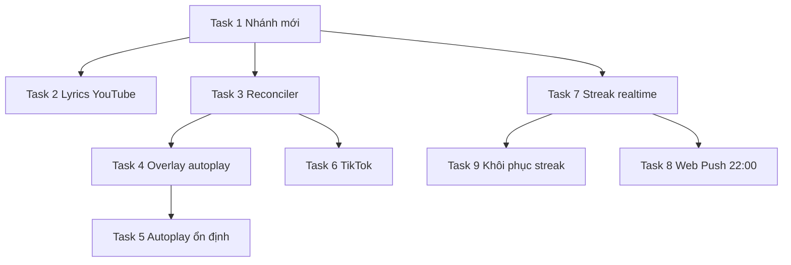

# Kế hoạch: Lyrics chính chủ · Độ tin cậy phát nhạc · Streak realtime · Web Push · Khôi phục streak

> **Dành cho agent thực thi:** Làm tuần tự theo từng Task. Mỗi Task phải: (1) viết test trước nếu là logic thuần (TDD, `bun test`), (2) code, (3) chạy `bun test` toàn bộ, (4) commit riêng với message dạng `feat(scope): ...` / `fix(scope): ...`.
> Đọc [CLAUDE.md](../../../CLAUDE.md) trước khi bắt đầu. **Không sửa** những phần không liên quan, giữ nguyên comment cũ.
> Mọi chuỗi UI hiển thị cho người dùng viết **tiếng Việt có dấu**.

**Ngày lập:** 2026-10-13
**Múi giờ nghiệp vụ:** `APP_TIMEZONE` (mặc định `Asia/Ho_Chi_Minh`, xem [checkin.js](../../../src/checkin.js#L6-L10))

---

## 0. Bản đồ code liên quan (đã khảo sát)

| Khu vực | File | Ghi chú |
|---|---|---|
| Lyrics server | [src/lyricsService.js](../../../src/lyricsService.js) | `fetchLyrics()` hiện là chuỗi YouTube CC → LRCLIB → Zing MP3 (dòng 162–234) |
| Phụ đề YouTube | [src/providers/youtubeCaptions.js](../../../src/providers/youtubeCaptions.js) | `detectOriginalLanguage`, `selectOriginalCreatorTrack`, `fetchYouTubeCreatorCaptions`, `probeYouTubeCcLyrics` |
| Lyrics client | [public/lyrics-client.js](../../../public/lyrics-client.js) | `fetchLyricsClient()` gọi `/api/lyrics` rồi **fallback LRCLIB trực tiếp từ trình duyệt** (dòng 94–159) |
| Lyrics guest | [public/guest.js](../../../public/guest.js) ~dòng 2665 | gọi `fetchLyricsClient` |
| Lyrics host | [public/host.js](../../../public/host.js#L373-L438) | `loadLyrics()` |
| API lyrics | [server.js](../../../server.js#L1563-L1594) | `GET /api/lyrics` |
| Probe badge CC | server.js dòng ~1215, ~1403, ~1781 | `probeYouTubeCcLyrics` → `hasCcLyrics` |
| Player host | [public/host.js](../../../public/host.js#L1429-L1689) | `syncPlayer()`, `armPlaybackWatchdog()` (1705), `showPlaybackRecovery()` (1695), `pageshow` (1756) |
| YT IFrame init | [public/host.js](../../../public/host.js#L340-L365) | `autoplay: 0`, `onAutoplayBlocked → showPlaybackRecovery` |
| TikTok player | [public/host.js](../../../public/host.js#L1262-L1426) | `<audio id="tiktok-audio-player">`, `playTikTok()` |
| TikTok server | [src/tiktok.js](../../../src/tiktok.js), [server.js](../../../server.js#L1547-L1561) | `/api/tiktok/stream` 302 redirect; `duration` lấy từ `d.duration` (thời lượng **video**) |
| WS terminal | [server.js](../../../server.js#L3023-L3047) | `ended` / `error` / `skip` + `playbackToken` |
| Checkin | [src/checkin.js](../../../src/checkin.js), server.js `/api/me/checkin` (1010), `hasCheckedInToday` (750, 806) |
| Streak UI guest | [public/guest.js](../../../public/guest.js#L89-L120), modal dòng 298–360 |
| Streak UI account | [public/account.js](../../../public/account.js#L331-L351) |
| Notification in-app | [public/notifications.js](../../../public/notifications.js) |
| DB schema/migration | [src/db.js](../../../src/db.js) |

---

## Task 1 — Tạo nhánh mới

```bash
git status            # đảm bảo working tree sạch; nếu không, hỏi user trước khi stash
git checkout main && git pull
git checkout -b feat/playback-lyrics-streak-overhaul
```

- Không commit file `.env`.
- Mỗi Task bên dưới = ≥1 commit trên nhánh này.

---

## Task 2 — Lyrics YouTube: CHỈ dùng phụ đề chính chủ, đúng ngôn ngữ bài hát

### 2.1 Mục tiêu / Tiêu chí chấp nhận
- Với `platform === "youtube"` (cả host và guest): nguồn lyrics **duy nhất** là phụ đề do creator upload (không ASR, không bản dịch tự động). **Không** gọi LRCLIB, **không** gọi Zing MP3, **không** fallback LRCLIB trong trình duyệt.
- Nếu không có phụ đề chính chủ hợp lệ → trả `{ ok:false, error:"no_creator_captions" }` và UI hiển thị "Video này chưa có lời bài hát chính chủ."
- Chọn đúng track theo **ngôn ngữ của bài hát** (không phải ngôn ngữ dịch). Bài Việt → track `vi`; K-pop → `ko` (không chọn `en` dịch, không chọn `ko-Latn` romanization); bài Anh → `en`.
- Badge "🎵 CC Lyrics" ở kết quả tìm kiếm/hàng đợi phải **nhất quán** với kết quả thực tế: có badge ⇔ fetch lyrics thành công.
- Spotify/SoundCloud/TikTok **giữ nguyên** pipeline LRCLIB → Zing hiện tại.

### 2.2 Lỗi hiện tại cần sửa (phát hiện khi khảo sát)
1. `fetchLyrics()` rơi xuống LRCLIB/Zing cho YouTube (lyricsService.js 186–230).
2. `lyrics-client.js` fallback LRCLIB trực tiếp trên trình duyệt (dòng 94–159) — với YouTube chỉ chặn MV/Live, video audio thường vẫn bị fallback.
3. **Cache key** chỉ là `artist:::title` (lyricsService.js 141) → một bài YouTube có thể nhận lyrics LRCLIB đã cache từ phiên Spotify cùng tên. Phải tách key theo nguồn: YouTube dùng `yt:<videoId>`.
4. `probeYouTubeCcLyrics()` chọn **track creator đầu tiên** bất kể ngôn ngữ (dòng 365–371), còn `fetchYouTubeCreatorCaptions()` dùng `selectOriginalCreatorTrack` theo ngôn ngữ → badge có thể sai.
5. `detectOriginalLanguage()` chỉ dựa vào title+artist; bài Việt viết không dấu / tiêu đề tiếng Anh → bị coi là `en` → có thể chọn track dịch tiếng Anh.
6. Negative cache lưu cả lỗi tạm thời (timeout/network) 3 phút.

### 2.3 Thiết kế mới
Tạo module mới **`src/providers/youtubeLyricsResolver.js`** (một nguồn sự thật dùng cho cả fetch và probe):

```js
export async function resolveYouTubeCreatorLyrics(videoId, {
  title, artist, fetchImpl, timeoutMs, mode /* "full" | "probe" */
}) → { ok, lines, language, trackName, reason }
```

Thuật toán:
1. Gọi InnerTube `player` (giữ client ANDROID hiện có; thêm fallback client `WEB` / `IOS` nếu ANDROID không trả `captions` — chỉ khi ANDROID trả 200 nhưng không có `captionTracks`).
2. Lấy `captionTracks` + `audioTracks` + `videoDetails` (title, author, shortDescription, keywords).
3. **Lọc track chính chủ** (hàm thuần `filterCreatorTracks`):
   - loại `kind === "asr"`, `vssId` bắt đầu `a.`, chứa `.translate`, có `tlang` trong `baseUrl`;
   - loại romanization: `languageCode` dạng `*-Latn`, hoặc `name` chứa `romaji|romanized|romanization|phiên âm`;
   - `baseUrl` phải qua `isAllowedCaptionUrl` (giữ SSRF guard).
4. **Xác định ngôn ngữ bài hát** (hàm thuần `detectSongLanguage`) theo thứ tự ưu tiên:
   a. `audioTracks[defaultAudioTrackIndex]`/`audioTrack.id` nếu có mã ngôn ngữ (vd `vi.4`, `ko.4`).
   b. Track được trỏ bởi `audioTracks[*].defaultCaptionTrackIndex` **nếu** là creator track.
   c. Script detection trên `title + artist + videoDetails.title + author + keywords + 300 ký tự đầu description` (mở rộng `detectOriginalLanguage`: thêm Thai `\u0E00-\u0E7F`, nhận diện bài Việt không dấu qua từ khoá phổ biến như `anh, em, yeu, nguoi, khong, mot` khi channel/description có dấu tiếng Việt).
   d. Nếu vẫn không chắc → `null` (không đoán bừa là `en`).
5. **Xác minh bằng nội dung** (quan trọng nhất): với tối đa 3 track ứng viên, tải XML, parse, chạy `detectTextLanguage(lines)` (tỉ lệ ký tự Hangul / kana / Hán / Thai / chữ Việt có dấu / Latin thuần). Chọn track mà **ngôn ngữ nội dung == ngôn ngữ bài hát**. Nếu ngôn ngữ bài hát `null` và chỉ có **1** creator track → chấp nhận track đó; nếu nhiều track → ưu tiên track mà ngôn ngữ nội dung khớp `languageCode` của chính nó và không phải `en` khi title có ký tự non‑Latin.
6. **Xếp hạng khi cùng ngôn ngữ có nhiều track**: ưu tiên `name` chứa `lyrics|lời|가사|歌詞`; tránh `name` chứa `translation|dịch|english sub|번역`.
7. **Kiểm tra chất lượng**: tổng ký tự ≥ `CC_MIN_CHAR_TOTAL` (120), số dòng ≥ 6; bỏ dòng chỉ gồm `[Music]`, `[Âm nhạc]`, `♪`, ký hiệu; bỏ dòng credit cuối (`Subtitles by`, `Phụ đề bởi`, `Vietsub by`...).
8. `mode: "probe"` dùng **cùng** logic (để badge nhất quán) nhưng cache kết quả đầy đủ để fetch lần sau dùng lại (không tải 2 lần).

### 2.4 Các bước thực hiện
- [ ] **2.4.1** Viết test thuần `tests/youtube-lyrics-resolver.test.mjs` với `fetchImpl` giả lập:
  - bài Việt có track `vi` + `en` (dịch) → chọn `vi`;
  - K-pop có `ko`, `ko-Latn`, `en` → chọn `ko`;
  - chỉ có `en` cho bài có tiêu đề Hangul → `no_creator_captions`;
  - tiêu đề không dấu nhưng nội dung track là tiếng Việt có dấu, track `languageCode="en"` gắn nhầm → nhận diện qua nội dung → chấp nhận;
  - chỉ có ASR → `no_creator_captions`;
  - track chỉ có "Cảm ơn đã xem" (< 120 ký tự) → reject;
  - `baseUrl` ngoài domain YouTube → reject.
- [ ] **2.4.2** Implement `youtubeLyricsResolver.js`; refactor `fetchYouTubeCreatorCaptions` và `probeYouTubeCcLyrics` trong `youtubeCaptions.js` thành wrapper mỏng gọi resolver (giữ export cũ để không vỡ import ở server.js).
- [ ] **2.4.3** Sửa `fetchLyrics()` trong `lyricsService.js`:
  - nếu `platform` là `youtube|yt`: nếu **không có `videoId`** → trả `{ok:false,error:"missing_video_id"}`; ngược lại gọi resolver và **return ngay** kết quả (thành công hay thất bại). Xoá nhánh fall‑through LRCLIB/Zing cho YouTube. Cập nhật comment dòng 1 cho đúng.
  - cache key YouTube: `yt:${videoId}`; nguồn khác giữ key cũ nhưng prefix `meta:`.
  - Negative cache chỉ cho lỗi "chắc chắn" (`no_creator_captions`, `no_matching_version`); **không** cache `timeout`, `network_error`, `player_api_error`.
  - Tăng timeout YouTube từ 3500 → 6000ms (vì giờ có thể tải tối đa 3 track).
- [ ] **2.4.4** Sửa `public/lyrics-client.js`: nếu `platform` là youtube → chỉ gọi `/api/lyrics`, **bỏ hoàn toàn** fallback LRCLIB trình duyệt; trả về object lỗi có `error` để UI phân biệt.
- [ ] **2.4.5** UI guest (guest.js ~2665) & host (`loadLyrics`, host.js 422–433): thông điệp rỗng cho YouTube: "Video này chưa có lời bài hát chính chủ (phụ đề do kênh đăng tải)." Thêm nhãn nguồn nhỏ "Phụ đề chính chủ · {LANG}" khi `source === "youtube_captions"`.
- [ ] **2.4.6** Host `loadLyrics` `trackKey` hiện là `artist:::title` (host.js 378) → với YouTube đổi thành `yt:${videoId}` để không giữ nhầm lyrics bài trước trùng tên. Áp dụng tương tự ở guest.
- [ ] **2.4.7** Cập nhật test cũ có giả định fallback cho YouTube (tìm trong `tests/` các file chứa `lrclib`/`zing` + `youtube`, ví dụ `tests/lyrics-order-prefetch.test.mjs`) cho khớp hành vi mới.
- [ ] **2.4.8** Kiểm thử tay với 5 video thật (ghi kết quả vào PR): 1 bài Việt có CC `vi`, 1 K‑pop có CC `ko`+`en`, 1 bài US có CC `en`, 1 video không CC, 1 video chỉ ASR.

---

## Task 3 — Host luôn phát ĐÚNG bài trong hàng đợi (không bao giờ phát bài "cache"/bài cũ)

### 3.1 Phân tích nguyên nhân (giả thuyết đã xác định qua code)
1. **Watchdog bị đánh lừa** (nguyên nhân chính khả nghi nhất): `armPlaybackWatchdog` (host.js 1709–1717) chỉ kiểm tra `player.getCurrentTime() >= 1` hoặc state `PLAYING/PAUSED`. Khi `loadVideoById(newId)` thất bại im lặng (video bị chặn embed, region lock, không có `onError`), IFrame vẫn giữ **video trước** → `getCurrentTime()` trả thời gian của video cũ, state `PLAYING` → watchdog nghĩ là ổn → bài cũ tiếp tục phát, hàng đợi kẹt. Không có chỗ nào so sánh `player.getVideoData().video_id` với `np.videoId`.
2. **Listener YT chồng chéo**: `player.removeEventListener` của YouTube IFrame API không tin cậy với handler dạng function → handler của các bài cũ có thể tích luỹ khi host mở lâu; mỗi handler có closure `eventPlaybackToken` cũ. Hiện an toàn nhờ token nhưng gây rò rỉ & khó debug.
3. **TikTok stream**: `/api/tiktok/stream` trả 302 không có `Cache-Control: no-store`; URL `src` giống hệt nhau giữa các lần → trình duyệt/audio element có thể dùng lại response/redirect cũ; metadata cache server 1h có thể giữ `streamUrl` đã hết hạn.
4. **Spotify**: nếu lệnh play thất bại, SDK tiếp tục track trước; watchdog chỉ kiểm tra `current_track.id === videoId` nhưng bỏ qua `linked_from.id` (track relinking) → có thể báo lỗi sai hoặc bỏ sót.
5. Host mở nhiều giờ → bfcache/tab discard/WS reconnect; `pageshow` chỉ xử lý `persisted`.

### 3.2 Thiết kế: "Playback Reconciler" (vòng đối soát)
Thêm trong host.js một hàm `reconcilePlayback()` chạy mỗi **3s** khi `started && latestState.nowPlaying`:
- Lấy `expected = { provider, videoId, playbackToken }` từ `latestState.nowPlaying`.
- Lấy `actual` theo provider:
  - YouTube: `player.getVideoData()?.video_id`, `getPlayerState()`.
  - Spotify: `spotifyPlayerState.track_window.current_track.id` hoặc `.linked_from.id`.
  - TikTok: `tiktokAudio.dataset.playbackToken` (gắn khi set src).
  - SoundCloud: id track hiện tại của widget (`getCurrentSound`).
- Nếu provider đang hoạt động ≠ expected.provider → dừng mọi player khác (gọi helper `stopAllPlayersExcept(provider)`).
- Nếu `actual.videoId !== expected.videoId`:
  - lần 1: buộc load lại (`player.loadVideoById(expected.videoId)` / `playTikTok` / `playSpotify`), đếm `mismatchCount`;
  - lần 2 liên tiếp (≥6s): `player.stopVideo()` để **ngăn bài cũ phát**, rồi gửi `{type:"error", code:"player_mismatch"}` để server chuyển bài.
- Không bao giờ để âm thanh của bài không khớp tiếp tục phát quá 6s.

### 3.3 Các bước
- [ ] **3.3.1** Tách logic thuần `decideReconcileAction({expected, actual, mismatchCount, elapsedMs})` sang file mới `public/playback-reconciler.js` (UMD giống `lyrics-client.js`) để test được bằng `bun test` (`tests/playback-reconciler.test.mjs`). Trả về `"ok" | "reload" | "stop_and_skip" | "stop_foreign_provider"`.
- [ ] **3.3.2** Sửa `armPlaybackWatchdog` (YouTube): thêm điều kiện `player.getVideoData()?.video_id === videoId`; nếu không khớp thì coi như **chưa phát**.
- [ ] **3.3.3** Trong `onStateChange` PLAYING (cả handler global dòng 350 và per‑track dòng 1549): nếu `getVideoData().video_id !== currentVideoId` → `stopVideo()` + reload ngay.
- [ ] **3.3.4** Thay cơ chế add/remove listener YT bằng **một dispatcher duy nhất** đăng ký 1 lần trong `onYouTubeIframeAPIReady`; dispatcher đọc `currentVideoId/currentPlaybackToken` hiện tại (bỏ `playbackEventHandlers` add/remove). Giữ đúng hành vi `sendTerminal` theo token.
- [ ] **3.3.5** TikTok: server `/api/tiktok/stream` thêm `res.set("Cache-Control","no-store")`; client set `src = /api/tiktok/stream?url=...&t=${playbackToken}`; trước khi set src mới gọi `pause(); removeAttribute("src"); load();`; gắn `tiktokAudio.dataset.playbackToken`. Trong `ended`/`error` handler bỏ qua nếu token không khớp `currentPlaybackToken`.
- [ ] **3.3.6** Server: khi `/api/tiktok/stream` lỗi upstream (403/410 do link hết hạn) → xoá cache metadata (`tiktokMetadataCache.delete`) và resolve lại 1 lần.
- [ ] **3.3.7** Spotify: chấp nhận `current_track.id === videoId || current_track.linked_from?.id === videoId` ở watchdog + reconciler.
- [ ] **3.3.8** Thêm `document.addEventListener("visibilitychange")` + `window "focus"`: khi tab hiện lại → chạy `reconcilePlayback()` ngay.
- [ ] **3.3.9** Log có cấu trúc `console.warn("[reconcile]", {expected, actual, action})` để debug khi host chạy lâu.
- [ ] **3.3.10** Kiểm thử tay: (a) cho vào hàng đợi 1 video bị chặn embed (vd video có nhãn bản quyền chặn nhúng) ngay sau 1 bài đang phát → phải tự chuyển sang bài kế, **không** phát lại bài cũ; (b) để host chạy ≥2 giờ với ≥30 bài lẫn provider; (c) ngắt mạng 30s rồi bật lại.

---

## Task 4 — Bấm Next hiện thông báo "Trình duyệt không cho phép tự động phát" rồi tự tắt

### 4.1 Nguyên nhân (từ code)
- YT IFrame được tạo với `autoplay: 0` (host.js 344) và `onAutoplayBlocked: () => showPlaybackRecovery()` (361). Khi `loadVideoById()` + `playVideo()` được gọi **từ callback WebSocket** (không phải trong user gesture), YouTube đôi khi phát sự kiện `onAutoplayBlocked` **tạm thời** rồi tự thử lại (thường là phát được nhờ sticky activation) → overlay `#playback-recovery` hiện rồi bị `hidePlaybackRecovery()` ẩn khi state PLAYING (dòng 353) ⇒ nháy UI.
- Các nguyên nhân phụ: iframe YouTube đang `display:none` (class `hidden`) lúc gọi `playVideo` khi chuyển từ Spotify/TikTok sang YouTube; iframe thiếu `allow="autoplay"` (cần kiểm tra thuộc tính iframe do YT API tạo); `playVideo()` gọi ngay sau `loadVideoById()` (thừa, có thể gây race).
- `showPlaybackRecovery()` còn **huỷ watchdog** (dòng 1697) → nếu bị chặn thật thì không tự skip.

### 4.2 Hướng khắc phục
- [ ] **4.2.1** **Debounce overlay**: `onAutoplayBlocked` / `play()` reject → không hiện ngay; đặt `autoplayBlockedTimer = setTimeout(1800ms)`; khi hết hạn kiểm tra lại: nếu provider hiện tại vẫn không phát (YT state ≠ PLAYING, audio.paused, v.v.) **mới** hiện overlay. PLAYING đến trước → huỷ timer. Không huỷ watchdog trong `showPlaybackRecovery` mà chuyển watchdog sang chế độ "chờ người dùng" (không skip khi overlay đang mở).
- [ ] **4.2.2** **Thử lại tự động trước khi làm phiền người dùng** (`attemptAutoplayRecovery()`):
  1. `playVideo()` lần nữa sau 300ms;
  2. nếu vẫn chặn: `player.mute(); player.playVideo();` → khi PLAYING thì `player.unMute()` + khôi phục volume (muted autoplay luôn được phép; unMute được phép nếu trang đã có sticky activation từ nút "Bắt đầu");
  3. chỉ khi cả 2 thất bại mới hiện overlay.
  Tương tự cho `<audio>` TikTok (`audio.muted = true; play(); → muted=false`).
- [ ] **4.2.3** Bỏ `player.playVideo()` dư sau `loadVideoById()` (dòng 1571) — `loadVideoById` đã tự phát; thay bằng kiểm tra sau 1s nếu state `CUED/UNSTARTED` thì mới gọi `playVideo()`.
- [ ] **4.2.4** Không dùng `display:none` cho container player sắp phát: đổi class ẩn của `#player` sang CSS `visibility:hidden; position:absolute; pointer-events:none` hoặc chỉ bỏ `hidden` **trước** khi gọi `loadVideoById` (đã đúng thứ tự cho YT nhưng cần kiểm tra các provider khác).
- [ ] **4.2.5** Đảm bảo iframe có `allow="autoplay; encrypted-media; picture-in-picture"`: sau khi `YT.Player` tạo iframe, gọi `player.getIframe().setAttribute("allow", ...)` **trước** lần phát đầu (nếu YT API không tự thêm). Kiểm tra trong DevTools.
- [ ] **4.2.6** Đổi text overlay thành hành động rõ ràng: "Nhấn để tiếp tục phát" + nút lớn; click → gọi play cho provider hiện tại và ẩn overlay.

---

## Task 5 — Chuyển bài Spotify/YouTube đôi khi không tự phát (phải click mới phát từ đầu) & Guest chạy giờ/lyrics ảo

### 5.1 Nguyên nhân thực tế
1. **Host bị Chrome thu hồi quyền phát âm thanh khi chạy tab ngầm:**
   - Khi bài Spotify kết thúc, host gọi `triggerSpotifyEnded()` và dừng âm thanh. Trong lúc server nhận lệnh, `advance` hàng đợi, broadcast state mới và host gọi `PUT /me/player/play` (mất khoảng 300–800ms), tab host rơi vào trạng thái hoàn toàn im lặng.
   - Với tab đang ở chế độ nền (`document.hidden === true`), Chrome phát hiện tab không còn phát âm thanh nên thu hồi đặc quyền autoplay ngầm và hạ mức ưu tiên hẹn giờ (timer throttling).
   - Khi lệnh phát Spotify gửi tới SDK, Spotify Web Playback SDK bị Chrome chặn audio element tự phát hoặc giữ ở trạng thái `paused: true, position: 0`.
   - Trong `host.js` (dòng 1726), `armPlaybackWatchdog` cho Spotify có điều kiện: `if (!spotifyReady || !spotifyDeviceId || document.hidden) { armPlaybackWatchdog(...); return; }` → khi tab ẩn, watchdog bị hoãn vô thời hạn, không skip và không báo lỗi.
   - Đến khi user click vào tab host, trình duyệt cấp lại user gesture → Spotify Web Playback SDK mới được mở khóa và tự phát bài từ 0:00 ("tự phát lại bài từ đầu").

2. **Guest tự đếm giờ và cuộn lyrics ảo dù host chưa phát:**
   - Trong `guest.js` (dòng 2713–2717):
     ```js
     const curNp = lastQueueState?.nowPlaying;
     const isYt = curNp && (curNp.provider === "youtube" || curNp.provider === "yt");
     guestLyricsAnchorPosition = 0;
     guestLyricsAnchorTime = performance.now();
     guestLyricsPaused = isYt ? true : false;
     ```
   - Code cũ chỉ đặt `guestLyricsPaused = true` cho YouTube; còn Spotify/TikTok/SoundCloud lại gán `guestLyricsPaused = false` ngay khi tải xong lyrics!
   - Khi `guestLyricsPaused = false`, loop animation trên guest tự tính `elapsed = performance.now() - guestLyricsAnchorTime` và đếm tăng dần 0:01, 0:02, 0:03... đồng thời cuộn lyrics từng dòng, dù host thực tế đang bị kẹt ở 0:00 và chưa phát ra tiếng.
   - Server khi `advance` bài mới thì reset `latestSpotifyPlaybackTick = null`, nên khi guest gửi `requestPlaybackTick`, server không có tick nào phản hồi để đính chính trạng thái dừng cho guest.

### 5.2 Hướng khắc phục
- [ ] **5.2.1** **Giữ "phiên âm thanh" luôn sống (Silent Audio Keeper) trên Host:**
  - Trong `start-btn.onclick` tạo `AudioContext` và phát 1 buffer im lặng lặp vô hạn (gain 0.00001) hoặc một phần tử `<audio loop>` âm thanh trắng cực nhỏ → tab host luôn giữ biểu tượng chiếc loa (Audible) trên tiêu đề tab của Chrome.
  - Khi tab luôn được coi là đang phát âm thanh, Chrome không bao giờ thu hồi quyền autoplay của Spotify SDK/YouTube khi đổi bài trong nền, và không bóp nghẹt timer.
  - Resume `AudioContext` tại các sự kiện `visibilitychange`, `focus`, `pageshow`.
- [ ] **5.2.2** **Chủ động kích hoạt & retry Spotify SDK:**
  - Trong `playSpotify()`: gọi `spotifyPlayer.activateElement?.()` trước khi gửi API.
  - Đặt timer kiểm tra sau 800ms và 1600ms: nếu bài hiện tại vẫn ở trạng thái `paused: true` hoặc `position === 0` dù đã gửi lệnh play, chủ động gọi `spotifyPlayer.resume()`.
- [ ] **5.2.3** **Không cho Watchdog hoãn vô hạn khi `document.hidden`:**
  - Sửa dòng 1726 trong `host.js`: cho phép watchdog kiểm tra tối đa 2 lần gia hạn (tổng 30–40s). Nếu Spotify SDK vẫn không phát được nhạc, gọi `attemptAutoplayRecovery()` hoặc gửi skip sang bài kế tiếp thay vì đứng im chờ user click.
- [ ] **5.2.4** **Chặn Guest chạy giờ ảo (Guest Lock-to-Host-Tick):**
  - Trong `guest.js`: **MỌI provider** (Spotify, YouTube, SoundCloud, TikTok) khi mới chuyển bài đều bắt buộc khởi tạo `guestLyricsPaused = true`.
  - Guest CHỈ ĐƯỢC chuyển sang `guestLyricsPaused = false` khi nhận được `playbackTick` chính thức từ Host/Server với `paused: false`.
  - Nếu chưa có tick `paused: false`, thanh tiến trình guest đứng yên ở 0:00, hiển thị trạng thái "Đang chuẩn bị phát nhạc..." và không cuộn lyrics.
- [ ] **5.2.5** **Server phát tick đồng bộ ngay khi chuyển bài:**
  - Trong `state.advance()` trên server: ngay khi chuyển sang bài mới, server gửi broadcast ngay một tick ban đầu:
    `{ type: "playbackTick", position: 0, paused: true, videoId: nextItem.videoId }`
    để mọi client lập tức neo tại vị trí 0:00 và biết rằng bài mới đang ở trạng thái chờ phát.
- [ ] **5.2.6** **Đồng bộ lại vị trí khi Host quay lại (Visibility Sync):**
  - Khi tab host `visibilitychange` từ ẩn sang hiện: gửi ngay một `broadcastSpotifyTick({ seek: true })` với vị trí thực tế của SDK để ép guest lập tức nhảy đúng về vị trí bài hát đang phát thực sự (kể cả khi vừa mới bắt đầu từ 0:00).
- [ ] **5.2.7** Thêm **Media Session API** (`navigator.mediaSession.metadata`, handlers `play/pause/nexttrack`) trên Host.
- [ ] **5.2.8** Test tay kịch bản:
  - Cho 3 bài Spotify liên tiếp vào hàng đợi.
  - Bật phát trên host, sau đó chuyển sang tab khác (hoặc minimize trình duyệt).
  - Mở trang guest trên điện thoại hoặc cửa sổ khác: xác nhận bài sau chuyển mượt mà, nhạc phát bình thường, guest không bị chạy trước khi nhạc chưa kêu.

---

## Task 6 — TikTok: hết nhạc nhưng vẫn phát đến hết thời lượng video

### 6.1 Nguyên nhân
- `fetchTikTokMetadata` lấy `duration = d.duration` (thời lượng **video**) và `streamUrl = d.music || d.music_info?.play || d.play` (src/tiktok.js 164–166). Khi `music` thiếu → fallback `d.play` (**file video mp4**) → phát cả tiếng video câm/nói. Khi dùng "original sound", file âm thanh dài bằng video, phần cuối là im lặng.
- Host không có giới hạn thời gian theo độ dài nhạc thực sự.

### 6.2 Hướng khắc phục
- [ ] **6.2.1** `src/tiktok.js`: ưu tiên `d.music_info.duration` (giây) cho `duration` nếu > 0, lưu thêm `musicDurationSec` và `videoDurationSec`; đánh dấu `streamKind: "music" | "video"`. Không fallback sang `d.play` trừ khi không còn lựa chọn — khi đó gắn `streamKind:"video"`.
- [ ] **6.2.2** Lưu `musicDurationSec` vào item hàng đợi (state.js `add`, DB nếu queue được persist — kiểm tra `server-persistence` test) và gửi xuống host trong `nowPlaying`.
- [ ] **6.2.3** Host: trong `timeupdate` TikTok, nếu `musicDurationSec > 0 && currentTime >= musicDurationSec + 0.5` → `pause()` và gửi `ended` (dùng chung guard `terminalReportedForToken`).
- [ ] **6.2.4** **Phát hiện im lặng & tối ưu tài nguyên (Giải pháp 2 tầng mượt mà):**
  - **Tầng 1 (Siêu nhẹ, không tốn thêm tài nguyên):** Ngắt phát tự động theo `musicDurationSec` (lấy từ `d.music_info.duration`). Điều này giải quyết ngay 95% video TikTok (khi nhạc chỉ dài 15–30s nhưng video kéo dài 60s).
  - **Tầng 2 (Bắt im lặng cuối bài cho original sound dài):** Vì hệ thống Jukebox chỉ có duy nhất **1 Host** phát âm thanh trong văn phòng (khách không stream trực tiếp), một bài TikTok 30s–60s ở bitrate 128kbps chỉ tiêu tốn ~16 KB/s (~1 MB toàn bộ bài hát), hoàn toàn siêu nhẹ và mượt cho server. Server chuyển `/api/tiktok/stream` sang stream pipe (chuyển tiếp luồng âm thanh có header CORS `Access-Control-Allow-Origin: *`), giúp Host kết nối Web Audio API `AudioContext.createMediaElementSource(tiktokAudio)` + `AnalyserNode` để ngắt bài ngay khi nhận thấy âm thanh im lặng (RMS < -50 dBFS) liên tục **>= 3.5s**.
  - Nếu proxy mạng upstream bị gián đoạn, tự động fallback an toàn về Tầng 1.
- [ ] **6.2.5** Test thuần cho `formatDurationSeconds`/parse metadata với JSON mẫu tikwm có `music_info.duration` khác `duration` (`tests/tiktok-metadata.test.mjs`).

---

## Task 7 — Streak cập nhật realtime khi sang ngày mới (không cần reload)

### 7.1 Hành vi mong muốn
- 23:59:59 hôm nay: chuỗi 5, 🔥 đang cháy (đã điểm danh).
- 00:00:00 ngày mai: pill lập tức chuyển **tắt lửa** (inactive), số vẫn hiển thị 5 (chuỗi còn giữ được nếu điểm danh hôm nay).
- Khi điểm danh → 6, 🔥 cháy.
- Nếu bỏ lỡ ≥1 ngày (last_checkin < hôm qua) → hiển thị chuỗi **đã mất** (vd "0" + trạng thái "Mất chuỗi" + gợi ý khôi phục ở Task 9).

### 7.2 Các bước
- [ ] **7.2.1** Server: thêm helper thuần `computeStreakView(user, now, tz)` trong `src/checkin.js` trả `{ displayStreak, checkedInToday, streakAlive, streakBroken, localDate, nextRolloverAt (ISO), restoreEligible }`. Dùng trong mọi chỗ trả `currentStreak` (server.js 338, 714, 750–761, 806–821) để client không tự suy luận sai. Test: `tests/streak-view.test.mjs` (các mốc 23:59:59, 00:00:00, bỏ lỡ 1 ngày, bỏ lỡ 2 ngày, DST không áp dụng cho VN nhưng vẫn test với tz khác).
- [ ] **7.2.2** Server gửi kèm `serverNow` để client tính lệch đồng hồ (`clockOffset = serverNow - Date.now()`).
- [ ] **7.2.3** Server scheduler `src/dayRollover.js`: tính ms tới nửa đêm `APP_TIMEZONE` kế tiếp, `setTimeout` → broadcast WS `{type:"day_rollover", localDate}` tới mọi client, rồi lên lịch lại. Đăng ký/cleanup giống `sessionPruneTimer` (server.js 280).
- [ ] **7.2.4** Client guest.js + account.js: 
  - `scheduleRolloverTimer(nextRolloverAt)` (setTimeout có bù `clockOffset`, +1s an toàn);
  - khi timer bắn **hoặc** nhận WS `day_rollover` **hoặc** `visibilitychange`/`focus` mà `localDate` đã khác → gọi `GET /api/me` (hoặc endpoint nhẹ `GET /api/me/streak`) để lấy `computeStreakView` mới và re-render pill + modal (tách hàm `renderStreakPill(view)` từ đoạn guest.js 89–120).
  - Timer dài có thể bị trễ khi máy sleep → ngoài setTimeout thêm `setInterval` 60s kiểm tra `localDate` (rẻ).
- [ ] **7.2.5** CSS trạng thái `inactive` đã có (`user-streak-pill inactive`); thêm trạng thái `broken` (lửa xám + gạch).

---

## Task 8 — 22:00 gửi Web Push cho player chưa điểm danh

### 8.1 Điều kiện môi trường (Đã xác nhận)
- **Domain HTTPS chính thức:** `https://music.laztar.xyz` (trang guest: `https://music.laztar.xyz/guest`).
- Service Worker và Push API hoạt động chuẩn trên domain này.
- Với iOS/Safari: người dùng cần "Thêm vào Màn hình chính" (PWA) để nhận thông báo đẩy nền (yêu cầu của iOS >= 16.4). Notification click sẽ trỏ trực tiếp về `https://music.laztar.xyz/guest?checkin=1`.

### 8.2 Thiết kế
- Thư viện: `web-push` (npm). VAPID keys trong `.env`: `VAPID_PUBLIC_KEY`, `VAPID_PRIVATE_KEY`, `VAPID_SUBJECT=mailto:...` (thêm vào `.env.example`, **không** commit `.env`). Script `scripts/generate-vapid.mjs`.
- DB (`src/db.js` migration):
  ```sql
  CREATE TABLE IF NOT EXISTS push_subscriptions (
    id TEXT PRIMARY KEY, user_id TEXT NOT NULL, endpoint TEXT NOT NULL UNIQUE,
    p256dh TEXT NOT NULL, auth TEXT NOT NULL, user_agent TEXT,
    created_at TEXT NOT NULL, last_success_at TEXT, failure_count INTEGER DEFAULT 0
  );
  CREATE TABLE IF NOT EXISTS push_reminder_log (
    user_id TEXT NOT NULL, local_date TEXT NOT NULL, kind TEXT NOT NULL,
    sent_at TEXT NOT NULL, PRIMARY KEY (user_id, local_date, kind)
  );
  ```
- Repository `src/repositories/pushRepository.js`.
- Service worker `public/sw.js` (scope `/`): `push` → `showNotification(title, {body, icon, badge, tag:"checkin-reminder", data:{url:"/?checkin=1"}})`; `notificationclick` → focus/mở tab và mở modal điểm danh. Serve với `Cache-Control: no-cache` + header `Service-Worker-Allowed: /`.
- `public/manifest.webmanifest` + icon (dùng `generate_image` nếu chưa có icon) để hỗ trợ iOS PWA.
- API:
  - `GET /api/push/vapid-public-key`
  - `POST /api/me/push/subscribe` (requireAuth, validate endpoint là https, giới hạn 5 subscription/user)
  - `DELETE /api/me/push/subscribe`
- UI guest: sau lần điểm danh đầu tiên hoặc trong modal streak, nút "🔔 Nhắc tôi điểm danh lúc 22:00" → `Notification.requestPermission()` (chỉ trong user gesture) → `pushManager.subscribe({userVisibleOnly:true, applicationServerKey})` → POST lên server. Hiển thị trạng thái bật/tắt; cho phép tắt.
- Scheduler `src/checkinReminder.js`: tính thời điểm 22:00 `APP_TIMEZONE` kế tiếp (env `CHECKIN_REMINDER_TIME=22:00`, bật/tắt bằng setting admin `checkinReminderOn`), khi tới giờ:
  1. query users `status='active'` có subscription và `last_checkin_date != today`;
  2. bỏ qua user đã có trong `push_reminder_log` hôm nay (idempotent khi restart server lúc 22:00–22:05);
  3. gửi song song có giới hạn (concurrency 10); nội dung: "🔥 Chuỗi {n} ngày sắp tắt! Điểm danh trước 0h để giữ chuỗi." (n = streak còn giữ được); nếu chuỗi đang 0: "Điểm danh hôm nay để bắt đầu chuỗi mới!".
  4. Lỗi 404/410 → xoá subscription; lỗi khác tăng `failure_count`, xoá khi ≥5.
  5. Nếu server khởi động sau 22:00 nhưng trước 23:30 và hôm nay chưa gửi → gửi bù.
- Đồng thời tạo notification in‑app (notificationRepo, `sourceType: "checkin_reminder"`, thêm label trong notifications.js dòng ~99).
- [ ] Test: `tests/checkin-reminder.test.mjs` với `webPush.sendNotification` giả lập + `now` giả lập (đúng người nhận, không gửi trùng, xoá subscription 410).

---

## Task 9 — Khôi phục streak: mỗi guest 1 lần / tháng (tham khảo TikTok)

### 9.1 Quy tắc nghiệp vụ (đề xuất — agent xác nhận với user nếu cần đổi)
- Chuỗi bị **đứt** khi bỏ lỡ **đúng 1 ngày** (gap = 1 ngày lỡ). Bỏ lỡ ≥2 ngày → không khôi phục được.
- Cửa sổ khôi phục: trong **ngày ngay sau ngày bị lỡ** (tức "hôm nay", nếu ngày lỡ là "hôm qua"), tới 23:59:59. Tham khảo TikTok: cho phép khôi phục trong thời gian ngắn sau khi mất chuỗi.
- Quota: **1 lần mỗi tháng dương lịch** theo `APP_TIMEZONE` (`month_key = YYYY-MM` của ngày thực hiện khôi phục). Không cộng dồn.
- Khôi phục **không** cộng điểm điểm danh cho ngày bị lỡ và **không** kích hoạt milestone/achievement cho ngày đó (chống farm). Chỉ nối lại chuỗi.
- Hoạt động được cả khi user **đã điểm danh hôm nay** (lúc đó chuỗi đã reset về 1): khôi phục → `current_streak = brokenStreak + 1 (ngày lỡ) + 1 (hôm nay)`. Milestone vượt qua do khôi phục: **không** thưởng hồi tố (ghi rõ trong UI).

### 9.2 Dữ liệu
- Migration `src/db.js`:
  ```sql
  ALTER TABLE users ADD COLUMN broken_streak INTEGER DEFAULT 0;      -- giá trị chuỗi trước khi đứt
  ALTER TABLE users ADD COLUMN broken_missed_date TEXT;              -- ngày bị lỡ (YYYY-MM-DD)
  ALTER TABLE checkins ADD COLUMN is_restored INTEGER DEFAULT 0;
  CREATE TABLE IF NOT EXISTS streak_restores (
    id TEXT PRIMARY KEY, user_id TEXT NOT NULL, month_key TEXT NOT NULL,
    missed_date TEXT NOT NULL, streak_before INTEGER NOT NULL, streak_after INTEGER NOT NULL,
    created_at TEXT NOT NULL, UNIQUE(user_id, month_key)
  );
  ```
  (dùng pattern migration hiện có trong db.js — kiểm tra cột đã tồn tại trước khi ALTER.)
- `performCheckin` (checkin.js 101–105): khi chuỗi đứt (`last_checkin_date !== yesterday` và có `last_checkin_date`), nếu gap đúng 1 ngày lỡ (`last_checkin_date === dayBeforeYesterday`) thì lưu `broken_streak = current_streak`, `broken_missed_date = yesterday`; ngược lại xoá 2 cột này.
- `computeStreakView` (Task 7) cũng phải tính trạng thái "đứt nhưng có thể khôi phục" khi **chưa** điểm danh hôm nay: `last_checkin_date === dayBeforeYesterday` → `restoreEligible` (nếu quota tháng còn).

### 9.3 Logic `performStreakRestore(db, userId, { now, timezone })` — `src/streakRestore.js`
Trong `db.transaction(...).immediate()`:
1. Tính `today`, `yesterday`, `dayBeforeYesterday`, `monthKey`.
2. Kiểm tra quota: `SELECT 1 FROM streak_restores WHERE user_id=? AND month_key=?` → nếu có: lỗi `"Bạn đã dùng lượt khôi phục chuỗi của tháng này"`.
3. Trường hợp A (chưa điểm danh hôm nay): `last_checkin_date === dayBeforeYesterday` → chèn checkin `local_date = yesterday, is_restored=1, base_points=0, streak_after = current_streak + 1`; cập nhật `current_streak += 1`, `last_checkin_date = yesterday` (để lần điểm danh hôm nay thành +1 bình thường).
4. Trường hợp B (đã điểm danh hôm nay, chuỗi reset): `last_checkin_date === today && broken_missed_date === yesterday && broken_streak > 0` → chèn checkin restored cho `yesterday` với `streak_after = broken_streak + 1`; cập nhật `current_streak = broken_streak + 2`; cập nhật `checkins.streak_after` của hôm nay.
5. Ngoài ra → lỗi `"Chuỗi không đủ điều kiện khôi phục"`.
6. Insert `streak_restores`, xoá `broken_*`, tạo notification in‑app "Đã khôi phục chuỗi {n} ngày 🔥".
7. Trả về `{ ok, streak, restoresLeftThisMonth: 0, view: computeStreakView(...) }`.

### 9.4 API & UI
- `GET /api/me/streak` → `computeStreakView` + `{ restoreAvailable, restoreUsedThisMonth, restoreResetsAt }`.
- `POST /api/me/streak/restore` (requireAuth, rate limit).
- Guest modal streak (guest.js 298–360) + account.js: khi `restoreEligible`, hiện card kiểu TikTok: "Chuỗi {n} ngày của bạn đã bị gián đoạn. Khôi phục ngay? (Còn 1 lượt trong tháng {MM})" + nút "Khôi phục chuỗi". Sau khi dùng: "Lượt khôi phục tiếp theo vào 01/{MM+1}". Hiệu ứng lửa bùng lại khi thành công.
- Admin (tuỳ chọn): xem lịch sử `streak_restores`.

### 9.5 Test `tests/streak-restore.test.mjs`
- Lỡ 1 ngày, chưa điểm danh → khôi phục → điểm danh → streak = n+2.
- Lỡ 1 ngày, đã điểm danh (streak=1) → khôi phục → streak = n+2.
- Lỡ 2 ngày → từ chối.
- Khôi phục lần 2 cùng tháng → từ chối; tháng sau → được.
- Ngày cuối tháng/đầu tháng (month_key theo ngày thực hiện).
- Không cộng điểm, không tạo ledger `daily_checkin` cho ngày restored.
- Concurrency: 2 request song song → chỉ 1 thành công (UNIQUE).

---

## Thứ tự đề xuất & phụ thuộc



Có thể chia 3 agent song song: **A** (Task 2), **B** (Task 3→4→5→6), **C** (Task 7→9→8). Tránh sửa cùng lúc `public/host.js` ở 2 agent.

## Checklist hoàn thành chung
- [ ] `bun test` xanh toàn bộ.
- [ ] Không còn đường gọi LRCLIB/Zing cho `platform=youtube` (grep xác nhận).
- [ ] Không có lỗi console mới ở host/guest.
- [ ] README cập nhật: lyrics YouTube chỉ dùng CC chính chủ; cấu hình VAPID; khuyến nghị autoplay cho máy host; luật khôi phục streak.
- [ ] `.env.example` thêm `VAPID_*`, `CHECKIN_REMINDER_TIME`.
- [ ] PR mô tả kết quả test tay của Task 2.4.8, 3.3.10, 5.2.8.

## Quyết định thiết kế đã chốt với người dùng
1. **Domain Web Push:** `https://music.laztar.xyz` (trang guest: `https://music.laztar.xyz/guest`). Thông báo click mở trực tiếp `https://music.laztar.xyz/guest?checkin=1`.
2. **Luật khôi phục streak:** Chỉ áp dụng khi đứt chuỗi trong **đúng 1 ngày** (ngày lỡ là hôm qua); khôi phục trong ngày hôm nay trước 23:59:59; mỗi tháng 1 lần duy nhất; không cộng dồn, không cộng điểm/thưởng milestone hồi tố cho ngày lỡ.
3. **Phát hiện im lặng TikTok:** Hệ thống văn phòng chỉ có 1 Host phát nhạc nên băng thông ~16 KB/s (~1MB cả bài) là hoàn toàn nhẹ và mượt. Áp dụng giải pháp 2 tầng: Tầng 1 cắt tự động theo `d.music_info.duration`, Tầng 2 phát hiện im lặng >3.5s qua Web Audio API của Host (nhờ stream pipe `/api/tiktok/stream`).
